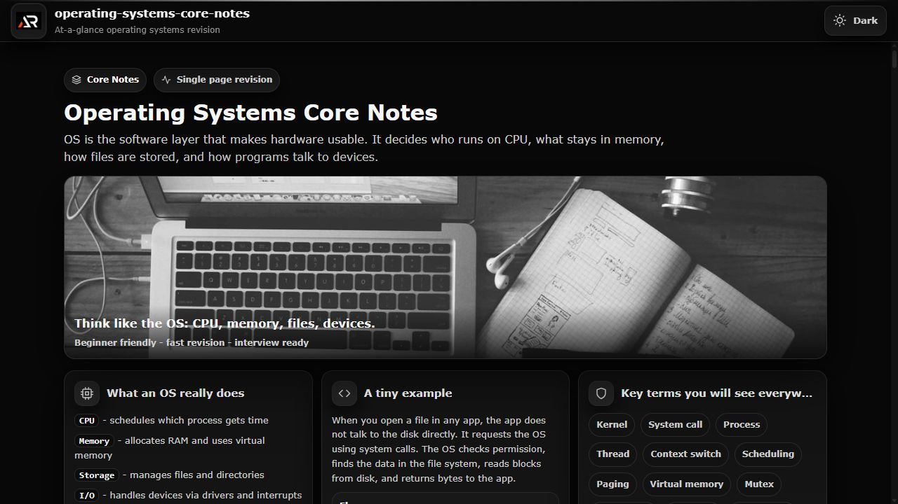

# Operating Systems Core Notes

A focused revision guide with original, interactive notes on operating-system fundamentals, processes and threads, CPU scheduling, synchronization, deadlocks, memory management, file systems, I/O, and interview questions.

## Included topics

- Operating-system basics, goals, responsibilities, and system calls
- Kernels, processes, threads, and CPU scheduling
- Synchronization, critical sections, and deadlocks
- Memory management, virtual memory, file systems, and I/O
- Interview-focused review questions
- Dark and light themes with browser-local preferences

## Source

These are the complete original notes from the former standalone repository, kept in this folder with their React components and assets.

## License

MIT